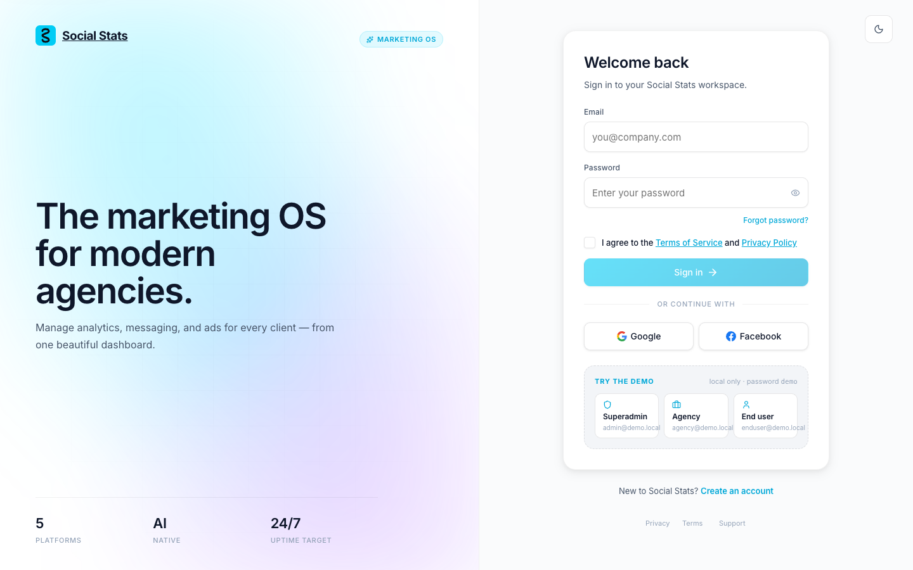
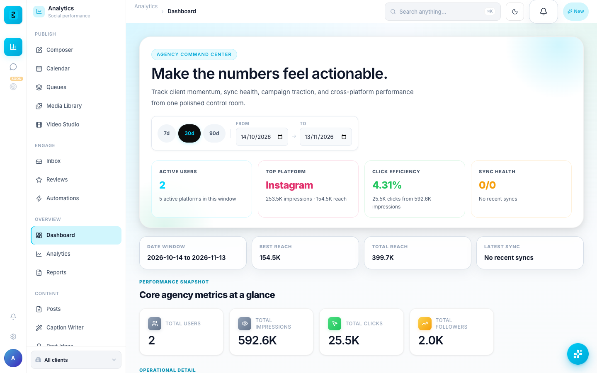

# Getting Started — Run Social Stats Locally

This guide takes you from zero to a running **Social Stats** instance on your own
machine, with seeded demo data so the dashboards aren't empty. No external API
keys are required for this walkthrough.

> New here? Social Stats is an open-source social media management & marketing
> platform (Django + React). See the [User Guide](USER_GUIDE.md) for what to do
> once it's running.

## 1. Prerequisites

| Tool | Version | Notes |
|---|---|---|
| Python | 3.11–3.12 | backend (Django 4.2 does not support 3.13+) |
| Node.js | 18+ | frontend |
| Redis | any recent | required for Celery (background sync + notifications) |
| Anthropic API key | optional | only for AI features — everything else runs without it |

Install Redis:

```bash
# macOS
brew install redis && brew services start redis
# Ubuntu / Debian
sudo apt install redis-server && sudo systemctl start redis
# Docker
docker run -d -p 6379:6379 redis
```

### Prefer Docker?

If you have Docker, the entire stack (PostgreSQL, Redis, API, Celery
worker + beat, frontend) runs with one command from the repo root:

```bash
cp .env.docker.example .env.docker            # set SECRET_KEY + FIELD_ENCRYPTION_KEYS
docker compose --env-file .env.docker pull && docker compose --env-file .env.docker up -d
# or build from source: docker compose --env-file .env.docker up -d --build
docker compose --env-file .env.docker exec backend \
  python manage.py demo_setup --i-know-this-is-not-production   # demo data
# app: http://localhost:3000
```

The stack runs with `DEBUG=False`, so the backend refuses to boot until
`.env.docker` has a real `SECRET_KEY`, `FIELD_ENCRYPTION_KEYS`, and either the
two webhook secrets or `ALLOW_UNSIGNED_WEBHOOKS=True` — the template explains
each. Pass `--env-file .env.docker` to every `docker compose` command.

The rest of this guide covers the manual (non-Docker) path.

## 2. Clone the repository

```bash
git clone https://github.com/cbsshekhawat18-lab/social-stats-social-media-manager.git social-stats
cd social-stats
```

## 3. Backend: install, configure, migrate, seed

```bash
cd backend
python -m venv .venv && source .venv/bin/activate
pip install -r requirements.txt

# Configure environment
cp .env.example .env
# The defaults work for local dev. To enable AI, set ANTHROPIC_API_KEY in .env.
# See docs/CONFIGURATION.md for every variable.

# Create the database schema (SQLite by default for local dev)
python manage.py migrate

# Seed 3 demo accounts + 90 days of synthetic analytics so dashboards aren't empty
python manage.py demo_setup

# Run the API server
python manage.py runserver
```

The backend now serves the API at `http://localhost:8000`.

### Demo login credentials

`demo_setup` creates three accounts (all with password `demo`). It refuses to
run when `DEBUG=False` unless you pass `--i-know-this-is-not-production`. For
the one-click sign-in buttons on `/login`, add `REACT_APP_SHOW_DEMO=true` to
`frontend/.env` (off by default; never set it for production builds):

| Account type | Email | Password | Lands on |
|---|---|---|---|
| Superadmin | `admin@demo.local` | `demo` | `/admin` |
| Agency member | `agency@demo.local` | `demo` | `/dashboard` + `/agency/*` |
| End user | `enduser@demo.local` | `demo` | `/u` |

> These are local-only demo credentials — never deploy them to production.



## 4. Frontend: install and start

In a new terminal:

```bash
cd frontend
npm install
cp .env.example .env
npm start
```

This opens `http://localhost:3000`.

## 5. Celery: background sync + notifications

Redis must be running first. In two more terminals:

```bash
# worker
cd backend && source .venv/bin/activate
celery -A dashboard worker -l info

# beat (scheduled tasks)
cd backend && source .venv/bin/activate
celery -A dashboard beat -l info --scheduler django_celery_beat.schedulers:DatabaseScheduler
```

> Celery is optional for a first look — the UI loads without it — but scheduled
> publishing, metric sync, and notification delivery need the worker + beat running.

## 6. You're in

Open `http://localhost:3000`, click the **agency** demo button on `/login`, and
you should now see the dashboard at `http://localhost:3000` populated with 90
days of sample analytics.



## Next steps

- [Configuration reference](CONFIGURATION.md) — every `.env` variable explained
- [Connect social accounts](CONNECT_ACCOUNTS.md) — Meta, Google, LinkedIn
- [Connect WhatsApp](CONNECT_WHATSAPP.md) — Pinbot / WABA setup
- [User Guide](USER_GUIDE.md) — how to use each module
- [FAQ & Troubleshooting](FAQ_TROUBLESHOOTING.md) — if something doesn't work
