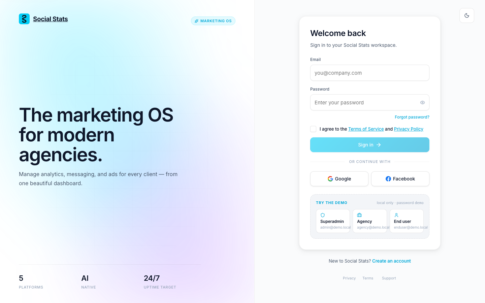
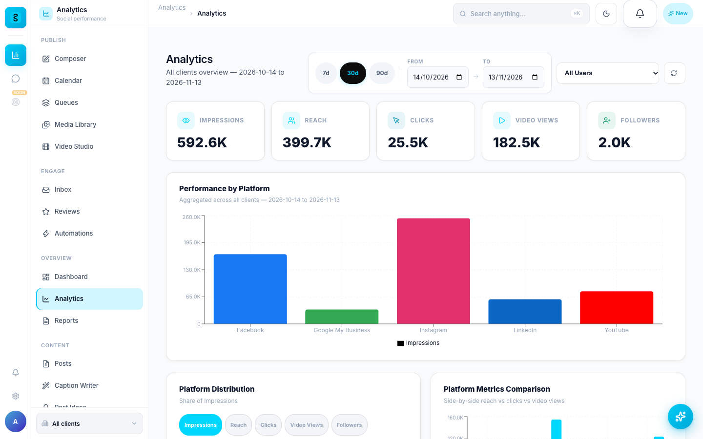
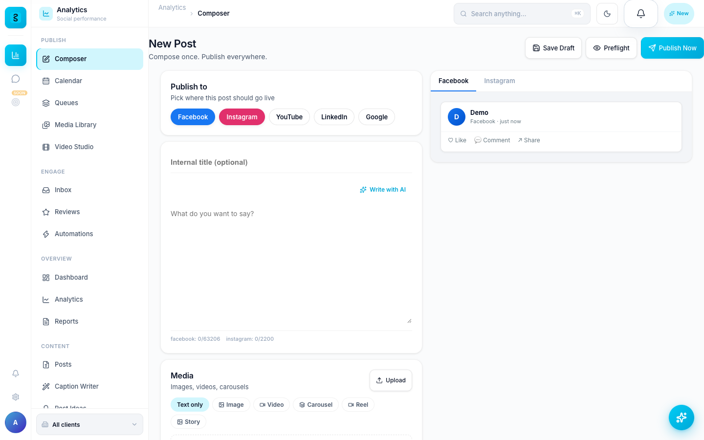
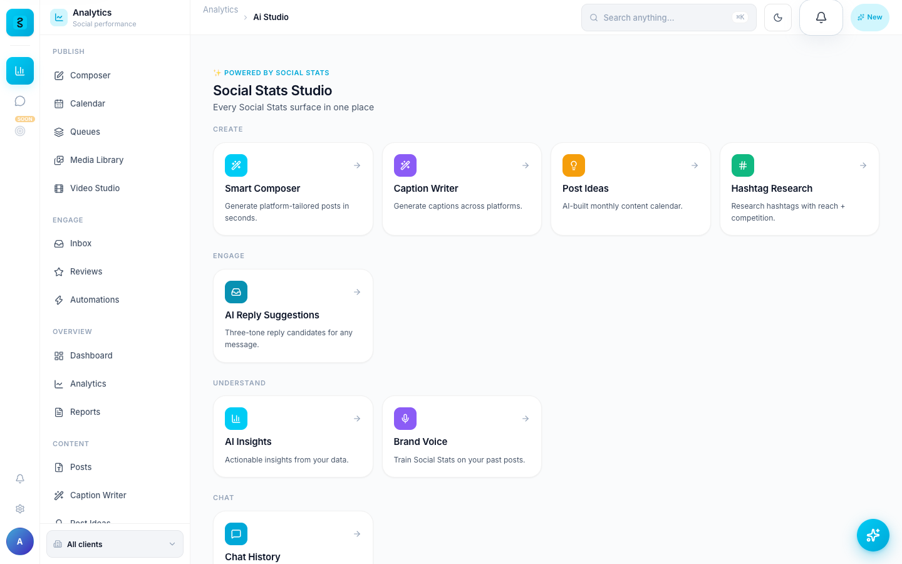
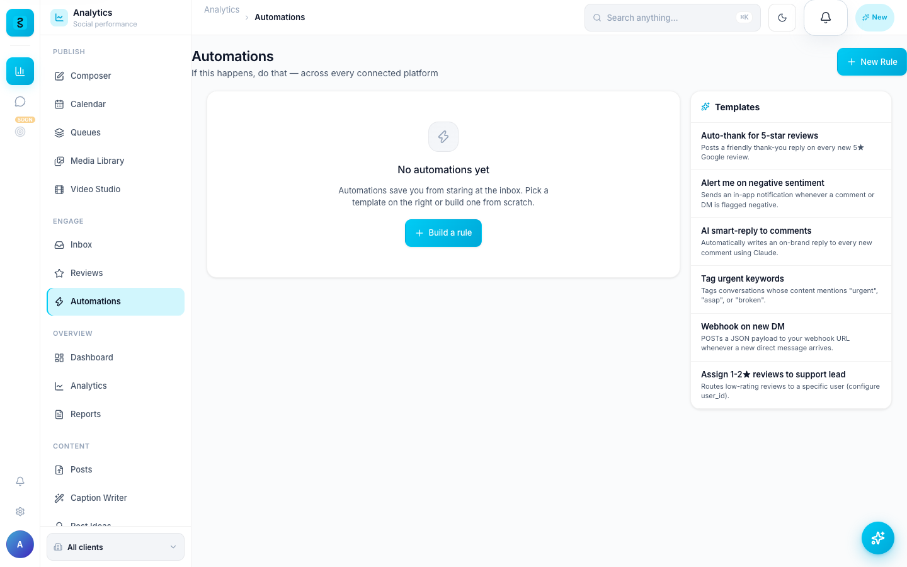

# User Guide

How to use Social Stats once it's running. This tour uses the three demo accounts
from `demo_setup` (all password `demo`).

## The three account types

| Account | Demo login | Shell | What they can do |
|---|---|---|---|
| **Superadmin / staff** | `admin@demo.local` | `/admin` | Full admin shell: manage all users, agencies, workspaces, audit logs, trust/approval queues, platform compliance. |
| **Agency member** | `agency@demo.local` | `/dashboard` + `/agency/*` | Shared agency dashboard across all client workspaces, plus agency-only management (clients, approvals, marketplace profile). |
| **End user** | `enduser@demo.local` | `/u` | A single workspace they own; connect their own accounts, view their analytics, approve agency work. |

Sign in via `/login` — one-click buttons pick the account for you.

---

## Modules

### Analytics dashboard
Daily-metric ingestion across the 5 platforms feeds per-client dashboards and a
time-series API. With demo data you'll see 90 days of charts; with real connected
accounts (see [CONNECT_ACCOUNTS.md](CONNECT_ACCOUNTS.md)) it shows live numbers.
AI-narrated monthly reports summarize the trends in plain language.

### Composer + scheduling
One editor with per-platform formatting, brand-voice **AI captions**, scheduling,
and a **content calendar**. Agency posts can route through **approval flows**
before they publish. Drafting and scheduling work without connected accounts;
actually publishing needs them.

### Unified inbox
One queue across DMs, comments, and Google reviews, with **AI reply suggestions**
in your brand voice. Reply, assign, and resolve from a single screen.

### WhatsApp bot builder
A visual flow editor with conditional branches and **AI chat nodes**. Build
automated WhatsApp conversations, capture leads (pushed to the CRM), and route
click-to-WhatsApp ad traffic into flows. Requires a connected WhatsApp account —
see [CONNECT_WHATSAPP.md](CONNECT_WHATSAPP.md).

### Agency marketplace
A two-sided directory: end users can browse and invite an agency to manage their
workspace, and agencies can publish a marketplace profile. Invitations and
client/agency relationships are managed here.

### AI assistant
A **Cmd/Ctrl+J** assistant with tool use, available throughout the app. It draws
on brand-voice training, your analytics, and insights/forecasts. Powered by
Anthropic Claude — set `ANTHROPIC_API_KEY` to enable it (see
[CONFIGURATION.md](CONFIGURATION.md)).

### Automations
IF-this-THEN-that rules across every connected platform, such as a keyword in a
comment triggering a template reply. Start from a blank rule or one of the
templates: auto-thanks for 5-star reviews, alerts on negative sentiment, AI
smart replies to comments, tagging urgent keywords, a webhook on every new DM.

---

## A suggested first walkthrough (demo data)

1. Sign in as **agency** (`agency@demo.local`) → land on `/dashboard`; explore the
   cross-client analytics.
2. Open the **composer**, draft a post, try an AI caption, and schedule it on the
   calendar.
3. Open the **inbox** and try an AI reply suggestion.
4. Sign in as **end user** (`enduser@demo.local`) → see the single-workspace view
   and the agency relationship.
5. Sign in as **superadmin** (`admin@demo.local`) → browse the admin shell, audit
   log, and approval queues.

When you're ready for real data, connect accounts
([social](CONNECT_ACCOUNTS.md) / [WhatsApp](CONNECT_WHATSAPP.md)) and turn off the
demo seed.
