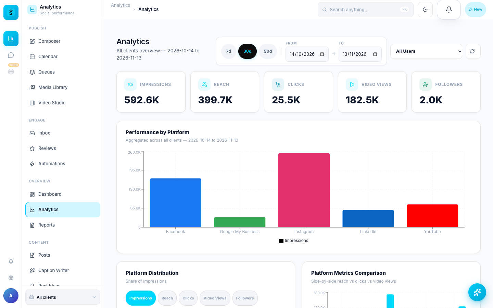

# Features

Everything in the Social Stats 2.0.0 code, grouped by what you do with it. The
numbers were counted in that code: 93 data models, 388 API endpoints, 52
background tasks, 15 scheduled jobs and 400 backend tests, all passing.

## Platforms

| Platform | Publishing | Analytics | In the inbox |
|---|---|---|---|
| Facebook | Posts | Daily Page metrics | Post comments |
| Instagram | Posts | Daily account metrics | Comments |
| YouTube | Videos | Daily channel metrics | Comments |
| LinkedIn | Posts | Daily page metrics | Post comments |
| Google Business Profile | Posts | Daily profile metrics | Reviews |
| WhatsApp Business | Campaigns and templates | Bot analytics | Messages |

Facebook Page DMs need the `pages_messaging` permission, which Social Stats does
not request, so the inbox pulls Page comments instead.
[Connect social accounts](CONNECT_ACCOUNTS.md) lists the exact scopes.

## Publish

- **Composer.** Write a post once, then format it for each platform, with
  brand-voice AI captions one click away.
- **Content calendar.** Schedule posts; the scheduler runs every minute.
- **Client approval.** Agency posts can route through the client's approval
  before they publish.
- **Queues, media library and video studio** beside the composer.
- **Drafts without accounts.** Drafting and scheduling work before any account
  is connected; publishing needs one.
- **Typed publish failures.** An expired token deactivates the credential and
  raises an alert; a rate limit becomes a retry.

The publishers for all five platforms sit behind one orchestrator, each tested
against a mocked platform API: 59 tests (`test_publishers_facebook` 13,
`test_publishers_instagram` 13, `test_publishers_remaining` 25,
`test_orchestrator` 8).

## Engage

- **Unified inbox.** Comments from Facebook, Instagram, YouTube and LinkedIn,
  Google reviews and WhatsApp messages in one queue, synced every five minutes.
- **AI reply suggestions** in your brand voice. Reply, assign and resolve from
  one screen.
- **Reviews.** Manage Google Business Profile reviews next to everything else.
- **Automations.** IF-this-THEN-that rules, from a blank rule or a template:
  auto-thanks for 5-star reviews, alerts on negative sentiment, AI smart replies
  to comments, tagging urgent keywords, a webhook on every new DM.
- **Notifications.** An internal event bus drives in-app and email
  notifications and smart watchers.
- **Audit log.** Who did what, and when, in every workspace.

Automations and notifications: 55 tests (`test_automation` 21,
`test_event_bus` 14, `test_audit_notifications` 14,
`test_notification_centralization` 6).

## Measure

- **Analytics dashboards.** Impressions, reach, clicks, video views and
  followers per client, synced daily by Celery.
- **Per-platform tables and charts** with date-range filters.
- **Reports.** Exportable reports, and AI-narrated monthly reports that explain
  the trends in plain language.
- **Sync logs and alerts.** Every sync is logged, and alerts fire when a metric
  needs attention.
- **Demo data.** `demo_setup` seeds three accounts and 90 days of sample
  analytics, so the charts are never empty.

## AI Studio

- **An assistant on Cmd/Ctrl+J**, with tool use, on every screen.
- **Smart Composer and Caption Writer** for platform-tailored posts and captions.
- **Post Ideas and Hashtag Research**: a month of ideas, and hashtags with reach
  and competition.
- **Brand Voice**, trained on your past posts, and **AI Insights** from your own
  analytics.

The AI features use Anthropic Claude through your own `ANTHROPIC_API_KEY`.
Everything else works without one.

## WhatsApp

- **A visual bot-flow editor** for click-to-WhatsApp bots, with conditional
  branches and AI chat nodes.
- **Human hand-off.** A queue moves a conversation from the bot to a person.
- **Campaigns and templates.** Contacts, lists, message templates and campaigns,
  plus a template gallery.
- **Leads.** Captured leads land in a CRM with their conversation history.
- **Bot analytics** per flow.

[Connect WhatsApp](CONNECT_WHATSAPP.md) covers the account and the webhook.

## Agencies

- **Per-client workspaces.** One agency, many client brands.
- **Granular permissions**, invites and manage-requests per client.
- **Tenant isolation** enforced on every endpoint, not only in the interface.
- **Agency marketplace.** A two-sided directory with profiles, reviews, invites,
  manage-requests and disputes.
- **Admin shell** at `/admin`: users, clients, staff access, the audit log, and
  approval and trust queues.

Agency workspaces: 56 tests (`test_tenant_isolation` 31,
`test_unified_permission` 16, `test_tenant_scoped_agency` 9).

## Platform and security

- **Encrypted tokens you can rotate.** Platform tokens are Fernet-encrypted at
  rest; `rotate_encryption_keys` re-encrypts them under a new key.
- **Sign-in.** JWT, Argon2 password hashing, MFA (TOTP), session management and
  brute-force protection (django-axes).
- **Safe uploads.** Files are typed from their content, not their name; SVG,
  HTML and polyglots are rejected.
- **Refuses weak config.** With `DEBUG` off, the app will not start on a weak
  key, missing secrets or a wildcard host.
- **Realtime and offline.** Live updates over WebSockets (Django Channels), and
  an installable app that works offline.
- **Privacy tooling.** Data export and deletion, with an hourly sweep of pending
  deletions.

Version 2.0.0 added 73 security tests for this work: uploads, social sign-in,
webhooks, client IP handling and production configuration.
[Security](security.md) has the details.

## The three account types

| Account | Lands on | What they see |
|---|---|---|
| Superadmin and staff | `/admin` | The full admin shell: users, agencies, workspaces, audit logs, trust and approval queues |
| Agency member | `/dashboard` | A shared dashboard across every client workspace, plus agency management at `/agency/*` |
| End user | `/u` | One workspace they own: connect accounts, see their analytics, approve agency work |

## Stack

| Layer | What |
|---|---|
| Backend | Django 5.2 LTS, Django REST Framework |
| Sign-in | JWT (SimpleJWT), Argon2, django-axes, MFA (TOTP) |
| Tasks | Celery and Redis; Celery beat runs 15 scheduled jobs |
| Realtime | Django Channels (WebSockets) |
| Database | PostgreSQL in production, SQLite for local development |
| Frontend | React 18, React Router, TanStack Query, Zustand, Recharts |
| Images | `ghcr.io/cbsshekhawat18-lab/social-stats-backend` and `-frontend`, amd64 and arm64 |
